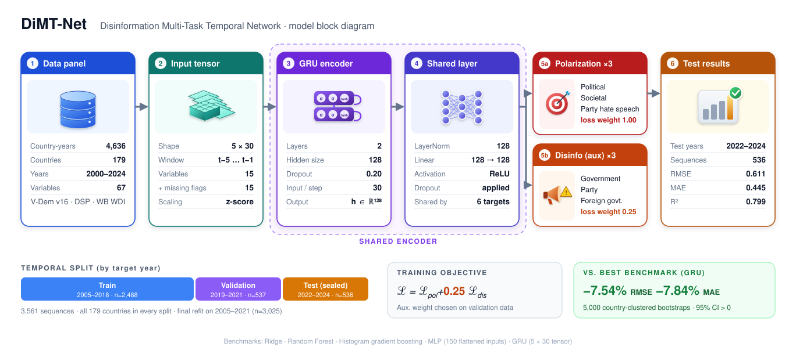

# DiMT-Net

**DiMT-Net (Disinformation Multi-Task Temporal Network)**: code and derived data for a cross-national analysis of digital platforms, disinformation and political polarization.

[](https://doi.org/10.5281/zenodo.23608199)

**DOI:** [10.5281/zenodo.23608199](https://doi.org/10.5281/zenodo.23608199) (all versions) · v1.0.0: [10.5281/zenodo.23608200](https://doi.org/10.5281/zenodo.23608200)

## Model block diagram

<p align="center">
  
</p>

## Overview

This repository combines two analyses on a harmonised country-year panel built from:

- **V-Dem Dataset v16** (Varieties of Democracy)
- **Digital Society Project** indicators
- **World Bank** World Development Indicators

Coverage: 2000–2024, up to 179 countries.

### 1. Panel econometrics

- Researcher-created **platform-intensity index** (online media use, social-media campaigning, public social-media mobilisation)
- Strict specification: country and year fixed effects, country-specific linear trends, internet penetration and macro-institutional controls, two-way clustered inference (country and year)
- Robustness: multiple-testing adjustment, lagged and first-difference models, placebo tests, subperiods, leave-one-region-out
- Pathway-consistency models for government, party and foreign-government disinformation

### 2. Predictive modelling: DiMT-Net

- Five-year country sequences predict next-year polarization
- Two-layer **GRU** encoder with a shared representation and multi-task heads: three polarization targets + three auxiliary disinformation targets
- Developed on 2005–2021; evaluated once on an untouched **2022–2024** temporal test set (536 sequences, 179 countries)
- Benchmarks: plain GRU, Random Forest, MLP, histogram gradient boosting, Ridge regression
- Country-clustered bootstrap for uncertainty in error differences

| Model | Mean RMSE | MAE | R² |
|---|---|---|---|
| DiMT-Net | 0.611 | 0.445 | 0.799 |

Relative to the strongest benchmark (GRU), DiMT-Net lowers RMSE by 7.54% and MAE by 7.84%.

## Repository structure

```
data/        source notes and processed panel (raw V-Dem/DSP/WB files are not redistributed)
src/         data construction, econometric models, DiMT-Net and benchmarks
notebooks/   analysis notebooks
results/     output tables (CSV/XLSX)
figures/     publication figures
```

## Data sources and licences

Raw source data are publicly available from their providers and should be downloaded from them directly:

- V-Dem: https://www.v-dem.net/
- Digital Society Project: https://www.digitalsocietyproject.org/
- World Bank WDI: https://databank.worldbank.org/

## Citation

Sufian, M. A. (2026). *DiMT-Net: Digital Platforms, Disinformation and Political Polarization - code and data* (v1.0.0). Zenodo. https://doi.org/10.5281/zenodo.23608199

See also `CITATION.cff` (GitHub's "Cite this repository" button).

## Licence

Code is released under the MIT License.
